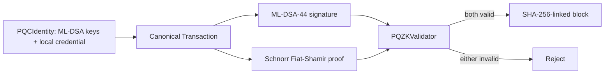

# PQ-ZKAuth: Privacy-Preserving Quantum-Resistant Authentication for Blockchain Transactions

## Abstract

Conventional blockchain authentication does not address the future cryptanalytic risk to classical public-key signatures and does not inherently prove authorization without exposing an authorization secret. PQ-ZKAuth combines ML-DSA-44 transaction signatures with a transaction-bound Schnorr Fiat–Shamir proof of knowledge, separating sender authentication from authorization. The prototype implements canonical transaction serialization, a structured validator, and a SHA-256-linked educational blockchain. On the recorded Windows 11 / Python 3.14.7 environment, 100-trial means were 4.94 ms for ML-DSA signing, 0.725 ms for proof generation, and 7.33 ms for normal-path end-to-end processing. All six validator security cases and four chain-integrity cases matched their expected outcomes. Relative to PQC-only authentication, the proposed configuration increased measured mean end-to-end latency by 40.2% while adding credential-witness privacy. The contribution is a reproducible, measured prototype that demonstrates the trade-off between post-quantum authentication, privacy-preserving authorization, and local processing cost.

**Keywords—** post-quantum cryptography, ML-DSA, zero-knowledge proof, Schnorr proof, blockchain authentication, privacy-preserving authorization.

## I. Introduction

Blockchain transaction validation requires trustworthy sender authentication and authorization. Classical signatures can authenticate a sender, but do not by themselves offer post-quantum assurance or prove possession of an authorization credential without exposing that credential. PQ-ZKAuth combines a NIST-standardized ML-DSA signature with a non-interactive Schnorr proof of credential knowledge, while retaining a deliberately lightweight blockchain ledger for demonstration.

Contributions are: (1) a modular PQC-plus-ZKP transaction validator; (2) strict separation between ML-DSA identity authentication and credential-proof authorization; (3) attack and chain-integrity validation; and (4) reproducible performance, baseline, ablation, and workload measurements.

## II. Problem Statement and Motivation

The target condition is `ML-DSA valid AND ZKP valid → accept`. A signature protects the canonical transaction fields from alteration and authenticates the holder of a registered ML-DSA private key. The ZKP proves knowledge of the credential bound to the sender without serializing the credential scalar. The goal is a demonstrable research prototype, not a complete cryptocurrency, anonymous ledger, or distributed deployment.

## III. Related Concepts / Background

FIPS 204 specifies ML-DSA for digital signatures. This implementation uses ML-DSA-44 through `pqcrypto`. The authorization protocol is a Schnorr proof of knowledge over secp256k1: for public credential commitment P and proof commitment R, the verifier checks `sG = R + cP`, where c is a SHA-256 Fiat–Shamir challenge bound to the transaction and commitments. The proof is zero-knowledge in the intended proof-of-knowledge construction, but its group is classical rather than post-quantum.

## IV. Proposed PQ-ZKAuth Architecture

The validator holds registered public ML-DSA keys and authorized public credential commitments. A block holds accepted transaction records, a prior hash, and its own SHA-256 hash. No consensus, mining, networking, balances, or smart contracts are claimed.

## V. Protocol Design

**Algorithm 1 — Registration**

1. Generate ML-DSA-44 `(pk, sk)` and random credential scalar `x`.
2. Compute public credential commitment `P = xG`.
3. Register `(user_id, pk)` and, for authorized users, `(user_id, P)` with the validator.
4. Keep `sk` and `x` local.

**Algorithm 2 — Transaction Authentication**

1. Construct a transaction with ID, sender, receiver, amount, timestamp, and nonce.
2. Canonically serialize the signing payload as sorted JSON.
3. Compute `signature = ML-DSA.Sign(sk, payload)` and attach it.

**Algorithm 3 — ZKP Authorization**

1. Select fresh random nonce `r`; compute `R = rG`.
2. Compute `c = H(domain, canonical transaction, P, R)`.
3. Compute `s = r + cx mod q`; attach public `(R, s)` as the proof.
4. Do not attach `x`.

**Algorithm 4 — Transaction Validation**

1. Check required transaction fields and a positive integer amount.
2. Verify ML-DSA signature under the registered sender public key.
3. Retrieve the sender authorization commitment and verify `sG = R + cP`.
4. Accept only if all checks pass; otherwise return the structured failure reason.

**Algorithm 5 — Block Addition**

1. Serialize accepted transaction records.
2. Create a block containing index, timestamp, records, and previous hash.
3. Set the block hash to SHA-256 of canonical block fields.
4. Append; chain validation recomputes each hash and prior-hash linkage.

## VI. Implementation

The prototype is Python 3.14.7 on Windows 11. `pqcrypto==1.0.0` provides ML-DSA-44 operations; `ecdsa==0.19.2` supplies secp256k1 arithmetic for the Schnorr proof and ECDSA baseline. `pandas` and `matplotlib` create tables and figures. The measured host reported 16 logical CPUs and 16,356,941,824 bytes RAM; no GPU was used.

## VII. Experimental Methodology

Independent PQC, ZKP, end-to-end, and configuration benchmarks each used 100 trials timed by `perf_counter_ns`. Descriptive statistics and normal-approximation 95% confidence-interval half-widths are saved in `results/`. The baseline is deterministic ECDSA/secp256k1 with SHA-256; it supplies classical authentication but not PQC authentication or credential-proof authorization. Ablation configurations are conventional ECDSA, PQC-only ML-DSA, and PQC+ZKP. Workloads are 10, 50, 100, 250, 500, and 1,000 sequential proposed transactions.

## VIII. Results and Discussion

### Table I. Technology / implementation stack

| Layer | Implementation |
|---|---|
| PQC signature | ML-DSA-44 via pqcrypto 1.0.0 |
| Authorization proof | Schnorr Fiat–Shamir proof over secp256k1 |
| Baseline | Deterministic ECDSA/secp256k1 with SHA-256 |
| Ledger | In-process SHA-256-linked blocks |
| Analysis | pandas 3.0.6, matplotlib 3.11.1 |

### Table II. Security validation

| Scenario | PQC | ZKP | Expected / observed |
|---|---:|---:|---|
| Valid transaction | pass | pass | accept / matched |
| Modified transaction | fail | fail | reject / matched |
| Invalid signature | fail | pass | reject / matched |
| Wrong user signature | fail | pass | reject / matched |
| Invalid ZKP | pass | fail | reject / matched |
| Valid PQC, unauthorized user | pass | fail | reject / matched |
| Valid chain | — | — | valid / matched |
| Three ledger mutations | — | — | invalid / matched |

### Table III. PQC performance (ms, n=100)

| Operation | Mean | Std. dev. | 95% CI half-width |
|---|---:|---:|---:|
| Key generation | 0.096 | 0.010 | 0.002 |
| Signing | 4.940 | 0.122 | 0.024 |
| Verification | 0.090 | 0.009 | 0.002 |

ML-DSA public/private/signature sizes were 1,312 / 2,560 / 2,420 bytes.

### Table IV. ZKP performance (ms, n=100)

| Operation | Mean | Std. dev. | 95% CI half-width |
|---|---:|---:|---:|
| Proof generation | 0.725 | 0.083 | 0.016 |
| Proof verification | 1.748 | 0.135 | 0.026 |

The canonical serialized proof was 223 bytes.

### Table V. Baseline and ablation results (mean ms, n=100)

| Configuration | Authentication | Verification | End-to-end | Bytes | PQ authentication | Private authorization |
|---|---:|---:|---:|---:|---|---|
| Conventional ECDSA | 0.404 | 1.381 | 1.786 | 64 | no | no |
| PQC-only ML-DSA | 4.966 | 0.105 | 5.071 | 2,420 | yes | no |
| PQC + ZKP | 5.655 | 1.456 | 7.111 | 2,643 | yes | yes |

The proposed configuration was 298.2% above the local conventional baseline and 40.2% above PQC-only end-to-end latency. The latter isolates the measured incremental cost of credential-proof authorization. These values are local implementation measurements, not universal cryptographic rankings.

### Table VI. Scalability results

| Transactions | Total ms | Avg. ms/tx | Throughput tx/s | Accepted |
|---:|---:|---:|---:|---:|
| 10 | 70.918 | 7.092 | 141.0 | 10 |
| 50 | 356.119 | 7.122 | 140.4 | 50 |
| 100 | 710.220 | 7.102 | 140.8 | 100 |
| 250 | 1790.022 | 7.160 | 139.7 | 250 |
| 500 | 3571.014 | 7.142 | 140.0 | 500 |
| 1000 | 7147.852 | 7.148 | 139.9 | 1000 |

Total processing time rose by approximately 9,979% from 10 to 1,000 transactions, consistent with increasing workload count, while average latency changed by 0.79% and throughput remained near 140 transactions/s. All workload chains were valid with zero rejected transactions.

## IX. Security Analysis

The tested cases establish that the implementation rejects changes to signed fields, signatures under a non-registered identity, malformed authorization proofs, and validly signed transactions lacking a registered credential commitment. Chain tests independently detect modified records, headers, and predecessor linkage. They do not prove security against all adversaries, guarantee anonymity, establish distributed-consensus safety, or make the Schnorr proof post-quantum.

## X. Deployment Trade-offs and Limitations

The security benefit is ML-DSA-based transaction authentication and proof-based authorization with the credential scalar remaining local. The costs are the measured signing/proof/verification time, 2,420-byte signature, 223-byte proof serialization, key and credential lifecycle management, and protocol complexity. The system is local and sequential; it lacks network latency, persistent secure key storage, revocation, balances, consensus, and production threat modelling. The classical proof group is the principal cryptographic limitation.

## XI. Conclusion and Future Work

PQ-ZKAuth demonstrates a reproducible integration of ML-DSA authentication and privacy-preserving credential knowledge for blockchain-style validation. Under the test environment it sustained about 140 sequential transactions/s, with the ZKP layer adding measurable latency and privacy authorization. Future work should evaluate a post-quantum authorization proof, introduce credential revocation and secure storage, benchmark under networked/distributed conditions, measure larger workloads, and assess smart-contract or decentralized-identity integration without changing the core acceptance rule.

## References

1. National Institute of Standards and Technology, *FIPS 204: Module-Lattice-Based Digital Signature Standard*, Aug. 2024. Available: https://csrc.nist.gov/pubs/fips/204/final
2. C. P. Schnorr, “Efficient Identification and Signatures for Smart Cards,” in *Advances in Cryptology—CRYPTO ’89*, 1990, pp. 239–252. Verify final formatting/page metadata against the publisher before submission.
3. A. Fiat and A. Shamir, “How to Prove Yourself: Practical Solutions to Identification and Signature Problems,” in *Advances in Cryptology—CRYPTO ’86*, 1987, pp. 186–194. Verify final formatting against the publisher before submission.
4. backbone-hq, “pqcrypto 1.0.0,” PyPI, 2026. Available: https://pypi.org/project/pqcrypto/
5. tlsfuzzer contributors, “python-ecdsa,” GitHub repository. Available: https://github.com/tlsfuzzer/python-ecdsa
